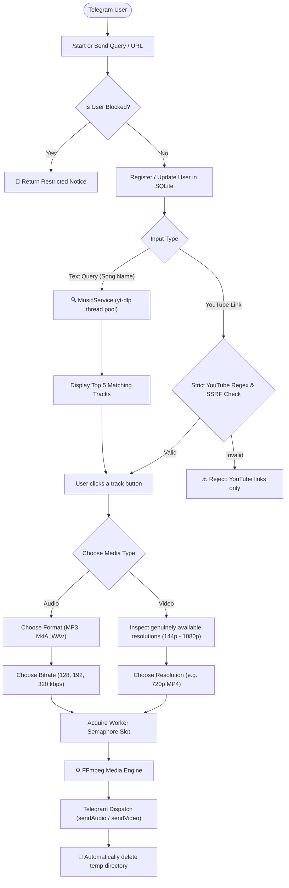
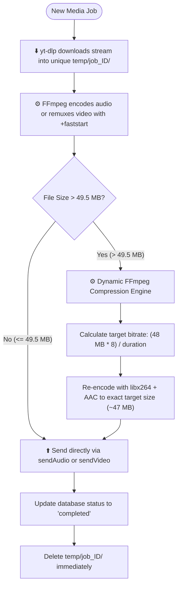

# 🎵 Telegram Music & Video Downloader Bot

> **Bot Name:** Music & Video Downloader ([@songsuperzxbot](https://t.me/songsuperzxbot))  
> **Developer:** Chandan ([@coder_chandan](https://t.me/coder_chandan))  
> **Repository:** [chandan0000001/music-video_telegrambot](https://github.com/chandan0000001/music-video_telegrambot)

A production-grade, asynchronous Telegram bot built with **Python 3.11+**, **aiogram 3**, **SQLite (WAL mode)**, and **FFmpeg**. It allows users anywhere in the world to search music, extract audio in high-fidelity formats (`MP3`, `M4A`, `WAV` at `128k`, `192k`, `320k`), and download videos in genuine resolutions (`144p` up to `1080p` MP4) from authorized YouTube sources with automated compression to fit Telegram limits.

---

## 📑 Table of Contents

1. [Architecture & Workflow](#-architecture--workflow)
   - [User Interaction Flowchart](#1-user-interaction-flowchart)
   - [Media Processing & Auto-Compression Pipeline](#2-media-processing--auto-compression-pipeline)
   - [Database Structure](#3-database-structure)
2. [Cross-Platform Installation Guide](#-cross-platform-installation-guide)
   - [Arch Linux](#a-arch-linux)
   - [Ubuntu / Debian](#b-ubuntu--debian)
   - [macOS](#c-macos-apple-silicon--intel)
   - [Windows 10 / 11](#d-windows-10--11)
   - [Android (Termux)](#e-android-via-termux)
3. [Bot Configuration Setup](#-bot-configuration-setup)
   - [1. Create Bot & Get Token via @BotFather](#1-create-bot--get-token-via-botfather)
   - [2. Find Your Telegram User ID](#2-find-your-telegram-user-id)
   - [3. Configure config.py](#3-configure-configpy)
4. [Running the Bot](#-running-the-bot)
5. [Bot Features & Usage Manual](#-bot-features--usage-manual)
   - [Searching Music](#searching-music)
   - [Direct YouTube Link Processing](#direct-youtube-link-processing)
   - [Supported Formats & Quality](#supported-formats--quality)
   - [User History](#user-history)
6. [Administrator System](#-administrator-system)
7. [Running 24/7 in the Background](#-running-247-in-the-background)
   - [Linux (systemd)](#linux-systemd-service)
   - [Termux (Android Background)](#termux-android-background-runner)
   - [Windows (Background Service)](#windows-background-execution)
8. [Automated Testing](#-automated-testing)
9. [Troubleshooting & FAQs](#-troubleshooting--faqs)

---

## 🏗️ Architecture & Workflow

### 1. User Interaction Flowchart



---

### 2. Media Processing & Auto-Compression Pipeline

Telegram's standard cloud API enforces a **50 MB** upload limit for standard bots. To ensure users always receive their files without errors, this bot uses an intelligent **two-tier processing pipeline**:



---

### 3. Database Structure

The bot uses SQLite with **Write-Ahead Logging (WAL)** and foreign keys enabled:

- **`users`**: Records Telegram ID, username, first name, join timestamp, last active timestamp, and blocked status.
- **`search_history`**: Records every search query with user ID, timestamp, and source.
- **`downloads`**: Tracks all download requests, media type, format, bitrate/resolution, status (`pending`, `completed`, `failed`), and created timestamp.
- **`bot_statistics`**: Real-time aggregated counters for total users, total searches, successful downloads, and failed downloads.

---

## 💻 Cross-Platform Installation Guide

The bot is pure Python with FFmpeg and SQLite, making it compatible with any modern operating system.

---

### A. Arch Linux

```bash
# 1. Update system and install system dependencies
sudo pacman -Syu python ffmpeg sqlite git

# 2. Clone or navigate to the project directory
cd /home/chandan/music_bot

# 3. Create and activate a Python virtual environment
python -m venv .venv
source .venv/bin/activate

# 4. Install Python dependencies
pip install -r requirements.txt

# 5. Verify FFmpeg installation
ffmpeg -version
```

---

### B. Ubuntu / Debian

```bash
# 1. Update repositories and install required packages
sudo apt update && sudo apt install -y python3 python3-venv python3-pip ffmpeg sqlite3 git

# 2. Navigate to project directory
cd /path/to/music_bot

# 3. Create and activate virtual environment
python3 -m venv .venv
source .venv/bin/activate

# 4. Install dependencies
pip install -r requirements.txt
```

---

### C. macOS (Apple Silicon & Intel)

```bash
# 1. Install Homebrew (if not already installed)
/bin/bash -c "$(curl -fsSL https://raw.githubusercontent.com/Homebrew/install/HEAD/install.sh)"

# 2. Install Python and FFmpeg via Homebrew
brew install python ffmpeg sqlite

# 3. Navigate to project folder
cd /path/to/music_bot

# 4. Create and activate virtual environment
python3 -m venv .venv
source .venv/bin/activate

# 5. Install dependencies
pip install -r requirements.txt
```

---

### D. Windows 10 / 11

#### Option 1: Using Windows Package Manager (`winget`)
Open **PowerShell as Administrator**:

```powershell
# 1. Install Python and FFmpeg
winget install Python.Python.3.11
winget install Gyan.FFmpeg

# 2. Close and reopen PowerShell so PATH updates, then verify:
python --version
ffmpeg -version

# 3. Navigate to your project folder
cd C:\Users\YourUsername\music_bot

# 4. Create and activate virtual environment
python -m venv .venv
.\.venv\Scripts\Activate.ps1

# (If PowerShell blocks script execution, run: Set-ExecutionPolicy -ExecutionPolicy RemoteSigned -Scope CurrentUser)

# 5. Install dependencies
pip install -r requirements.txt
```

#### Option 2: Manual Windows Setup
1. Download & install Python from [python.org](https://www.python.org/downloads/) (check **"Add python.exe to PATH"** during installation).
2. Download FFmpeg from [gyan.dev](https://www.gyan.dev/ffmpeg/builds/) (release essentials zip), extract to `C:\ffmpeg`, and add `C:\ffmpeg\bin` to your System Environment `PATH`.

---

### E. Android via Termux

You can run this bot 24/7 directly on an Android smartphone without root permissions!

```bash
# 1. Install Termux from F-Droid (do not use Google Play version)
# 2. Update Termux packages
pkg update && pkg upgrade -y

# 3. Install Python, FFmpeg, and build tools
pkg install python ffmpeg clang libxml2 libxslt -y

# 4. Grant storage permission (optional)
termux-setup-storage

# 5. Navigate to project directory
cd ~/music_bot

# 6. Create and activate virtual environment
python -m venv .venv
source .venv/bin/activate

# 7. Install dependencies
pip install -r requirements.txt

# 8. Prevent Android from sleeping while running
termux-wake-lock
```

---

## ⚙️ Bot Configuration Setup

### 1. Create Bot & Get Token via @BotFather

1. Open Telegram and search for [@BotFather](https://t.me/BotFather).
2. Send `/newbot`.
3. Choose a name (e.g. `Music & Video Downloader`) and a unique username ending in `bot` (e.g. `my_music_downloader_bot`).
4. BotFather will provide your **HTTP API Token** (e.g., `1234567890:AAFlLLXFL...`).
5. **Set Bot Metadata** (Optional but recommended):
   - Send `/setcommands` to BotFather, select your bot, and paste:
     ```text
     start - Launch the bot & main menu
     search - Search for music by song name
     history - View your search & download records
     help - Bot guide & supported media formats
     about - Architecture & bot specifications
     admin - Administrator control panel
     ```
   - Send `/setdescription` and paste:
     ```text
     Fast music & video downloader. Search songs, download MP3 (128-320kbps) & MP4 videos (144p-1080p) from authorized sources.
     ```

---

### 2. Find Your Telegram User ID

1. Open Telegram and message [@userinfobot](https://t.me/userinfobot).
2. It will reply with your numeric `Id` (e.g., `2063913663`).

---

### 3. Configure Environment Variables (`.env`)

Copy `.env.example` to create your private `.env` file (which is ignored by Git):

```bash
cp .env.example .env
```

Open `.env` in any text editor and paste your bot credentials:

```ini
# Telegram Bot Token from @BotFather
BOT_TOKEN=YOUR_TELEGRAM_BOT_TOKEN_HERE

# Administrator Telegram User IDs (Numeric)
ADMIN_IDS=2063913663

# Media Processing Limits (Optional)
MAX_UPLOAD_SIZE_MB=2000
MAX_DURATION_SECONDS=3600
MAX_CONCURRENT_DOWNLOADS=3
```

*(You can also configure `config.py` directly if preferred).*

---

## 🚀 Running the Bot

Always start the bot using your virtual environment:

### Linux / macOS:
```bash
source .venv/bin/activate
python bot.py
```

### Windows (PowerShell):
```powershell
.\.venv\Scripts\Activate.ps1
python bot.py
```

### Android (Termux):
```bash
source .venv/bin/activate
python bot.py
```

Upon launching, the bot output will confirm:
```text
[INFO] Starting Telegram long polling...
[INFO] Initializing Telegram Music & Video Downloader Bot...
[INFO] Database schema initialized and verified.
[INFO] FFmpeg engine verified successfully.
[INFO] Bot connected: @your_bot_username (ID: ...)
[INFO] Loaded 1 administrator ID(s).
```

---

## 📖 Bot Features & Usage Manual

### Searching Music
1. Type a song title or artist name directly (e.g. `Tum Hi Ho Arijit Singh`) or send `/search <query>`.
2. The bot queries YouTube search via non-blocking worker threads.
3. The **top 5 matching results** are displayed with title, artist, duration, and numbered inline buttons.
4. Click any track to choose **🎧 Audio** or **🎬 Video**.

### Direct YouTube Link Processing
1. Paste any valid YouTube link (e.g. `https://www.youtube.com/watch?v=...`, `https://youtu.be/...`, or YouTube Shorts).
2. Untrusted or malicious URLs (SSRF attempts, private IPs, non-YouTube domains) are strictly rejected.
3. The bot inspects available streams and lets you choose Audio or Video.

### Supported Formats & Quality
- **Audio:**
  - Formats: `MP3`, `M4A` (AAC), `WAV`
  - Bitrates: `128 kbps` (fast/lightweight), `192 kbps` (standard fidelity), `320 kbps` (maximum studio quality)
  - Native delivery using `sendAudio` with title, artist, duration, and thumbnail preview.
- **Video:**
  - Formats: `MP4` with H.264 video and AAC audio.
  - Resolutions: Only **genuinely available** stream heights (`144p`, `240p`, `360p`, `480p`, `720p`, `1080p`).
  - Streamable playback: Remuxed with `+faststart` so users can watch while downloading on Telegram.
  - Automatic compression: Videos exceeding 50 MB are automatically compressed to ~48 MB so Telegram cloud delivers them smoothly.

### User History
- Send `/history` or click **📜 My History** to see your recent search queries and download statuses.

---

## 🛡️ Administrator System

Only IDs configured in `ADMIN_IDS` can access admin tools. Unauthorized users receive an **"Access Denied"** notice.

### Admin Commands
| Command | Action |
|---|---|
| `/admin` | Interactive dashboard with real-time statistics and action buttons |
| `/stats` | View real-time metrics (Total users, today's joins, searches, successful/failed downloads) |
| `/users` | View recent registered users with IDs, usernames, and status |
| `/searchlogs` | View recent search queries across all users |
| `/downloadlogs` | View recent downloads with formats, qualities, and statuses |
| `/user <id>` | View complete profile, searches, and downloads for an individual user ID |
| `/block <id>` | Block a user from using the bot |
| `/unblock <id>` | Unblock a user |
| `/broadcast <msg>` | Broadcast an announcement to all registered users (with rate-limit pacing) |

### CSV Exports
From the `/admin` dashboard, click:
- `📥 CSV Users` — Downloads complete user directory as CSV.
- `📥 CSV Searches` — Downloads search logs as CSV.
- `📥 CSV Downloads` — Downloads media download logs as CSV.

---

## 🔄 Running 24/7 in the Background

### Linux (systemd service)

1. Create a systemd service file:
   ```bash
   sudo nano /etc/systemd/system/music-bot.service
   ```

2. Add the following content:
   ```ini
   [Unit]
   Description=Telegram Music & Video Downloader Bot
   After=network.target

   [Service]
   Type=simple
   User=chandan
   WorkingDirectory=/home/chandan/music_bot
   ExecStart=/home/chandan/music_bot/.venv/bin/python /home/chandan/music_bot/bot.py
   Restart=always
   RestartSec=5
   Environment=PYTHONUNBUFFERED=1

   [Install]
   WantedBy=multi-user.target
   ```

3. Enable and start:
   ```bash
   sudo systemctl daemon-reload
   sudo systemctl enable music-bot
   sudo systemctl start music-bot
   ```

4. Check logs:
   ```bash
   journalctl -u music-bot -f
   ```

---

### Termux (Android Background Runner)

Keep the bot running even when you close the Termux app:

```bash
# 1. Acquire wake lock to keep CPU active
termux-wake-lock

# 2. Run with nohup in background
nohup .venv/bin/python bot.py > logs/bot_background.log 2>&1 &

# 3. Check status
ps aux | grep python
```

---

### Windows (Background Execution)

You can run the bot in the background using PowerShell:

```powershell
Start-Process -NoNewWindow -FilePath ".\.venv\Scripts\python.exe" -ArgumentList "bot.py"
```

To stop it at any time:
```powershell
Stop-Process -Name "python"
```

---

## 🧪 Automated Testing

The bot includes an automated test suite covering all 15 core scenarios:

```bash
# Activate virtual environment
source .venv/bin/activate

# Run pytest
pytest tests/ -v
```

All 20 test cases will execute:
```text
tests/test_database.py::test_database_init_and_restart PASSED            [  5%]
tests/test_database.py::test_new_and_existing_user PASSED                [ 10%]
tests/test_database.py::test_search_and_download_history PASSED          [ 15%]
tests/test_database.py::test_block_unblock_and_csv_export PASSED         [ 20%]
tests/test_handlers.py::test_scenario_5_and_6_keyboard_generation PASSED [ 25%]
tests/test_handlers.py::test_admin_authorization_logic PASSED            [ 30%]
tests/test_handlers.py::test_scenario_12_and_13_admin_command PASSED     [ 35%]
tests/test_rate_limiter.py::test_user_rate_limiting PASSED               [ 40%]
tests/test_rate_limiter.py::test_admin_bypasses_rate_limit PASSED        [ 45%]
tests/test_rate_limiter.py::test_concurrency_manager PASSED              [ 50%]
tests/test_services.py::test_scenarios_3_and_4_search_music PASSED       [ 55%]
tests/test_services.py::test_format_duration_helper PASSED               [ 60%]
tests/test_services.py::test_scenario_7_ffmpeg_audio_processing PASSED   [ 65%]
tests/test_services.py::test_scenario_8_ffmpeg_video_processing PASSED   [ 70%]
tests/test_services.py::test_scenario_11_telegram_upload_failure_handling PASSED [ 75%]
tests/test_validators.py::test_valid_youtube_urls PASSED                 [ 80%]
tests/test_validators.py::test_scenario_9_invalid_youtube_urls PASSED    [ 85%]
tests/test_validators.py::test_scenario_10_unsupported_download_sources PASSED [ 90%]
tests/test_validators.py::test_sanitize_filename_prevents_traversal PASSED [ 95%]
tests/test_validators.py::test_validate_media_limits PASSED              [100%]
============================== 20 passed ==============================
```

---

## ❓ Troubleshooting & FAQs

### Q: Why does the bot say `BOT TOKEN NOT CONFIGURED`?
**A:** Open `config.py` and replace `PASTE_NEW_REGENERATED_BOT_TOKEN_HERE` with your actual token from `@BotFather`.

### Q: How does the bot send files larger than 50 MB on Telegram?
**A:** If a video's natural size exceeds 49.5 MB, the bot automatically triggers FFmpeg's target-bitrate compression engine to compress the video down to ~48 MB so Telegram's cloud API accepts it without failing.

### Q: How do I provide `cookies.txt` when deploying to Cloud Providers (Railway, Render, VPS)?
**A:** Because `cookies.txt` is in `.gitignore`, there are two convenient ways to supply it:
- **Cloud / PaaS (Railway, Render, Heroku, Fly.io):** Convert your `cookies.txt` to Base64 (`base64 -w 0 cookies.txt` on Linux/Mac, or `[Convert]::ToBase64String([IO.File]::ReadAllBytes('cookies.txt'))` on Windows). Add an environment variable in your provider's dashboard: `YOUTUBE_COOKIES_BASE64=<base64_string>`. The bot automatically generates `cookies.txt` on container startup!
- **VPS / Dedicated Servers (AWS, DigitalOcean, Hetzner):** After cloning the repo, simply upload `cookies.txt` using SCP (`scp cookies.txt user@vps_ip:/path/to/music_bot/`) or paste it directly using `nano cookies.txt`.

### Q: Does the bot clean up downloaded files?
**A:** Yes. Each download job operates in an isolated folder under `temp/job_<UUID>/` and is completely deleted in a `finally` block immediately after delivery or if an error occurs.

### Q: How can I change the rate limit?
**A:** Edit `RATE_LIMIT_REQUESTS` and `RATE_LIMIT_WINDOW` in `config.py`.
