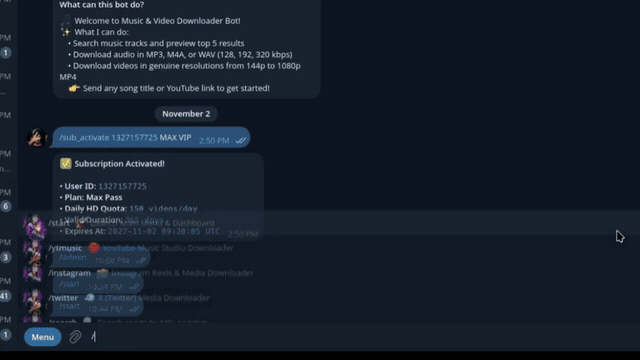
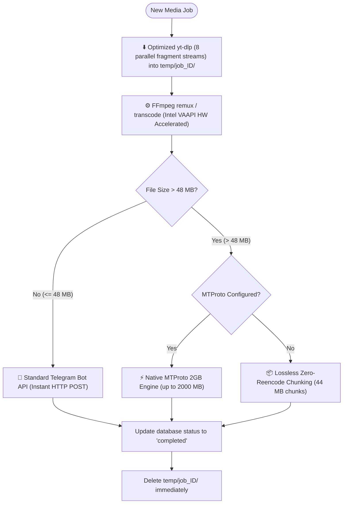
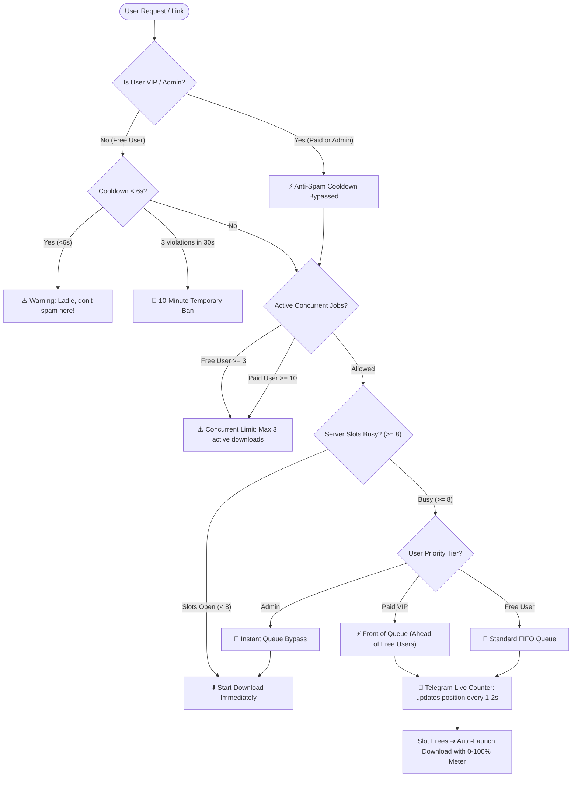

# 🎵 Telegram Music & Video Downloader Bot

> **Bot Name:** Music & Video Downloader ([@songsuperzxbot](https://t.me/songsuperzxbot))  
> **Developer:** Chandan ([@coder_chandan](https://t.me/coder_chandan))  
> **Repository:** [chandan0000001/music-video_telegrambot](https://github.com/chandan0000001/music-video_telegrambot)  
> **Production Status:** 🟢 **Live on AWS EC2 (Mumbai `ap-south-1`) — 24/7 Always-On**  
> **HD Demo Video:** [Watch on Streamable (1080p)](https://streamable.com/or78t5) | [Google Drive Mirror](https://drive.google.com/drive/folders/1DewLfOBfb7-Re-xuqbBZJh2KuI6ekCLG?dmr=1&ec=wgc-drive-%5Bmodule%5D-goto)

A production-grade, asynchronous Telegram bot built with **Python 3.11+**, **aiogram 3**, **SQLite (WAL mode)**, and **FFmpeg**. It allows users anywhere in the world to search music, extract audio in high-fidelity formats (`MP3`, `M4A`, `WAV` at `128k`, `192k`, `320k`), and download videos in genuine resolutions (`144p` up to `1080p` MP4) from authorized YouTube sources with automated compression to fit Telegram limits.

---

## 🎬 Video Demo

<div align="center">
  <a href="https://streamable.com/or78t5" target="_blank">
    
  </a>
  <br><br>
  <a href="https://streamable.com/or78t5">
    
  </a>
  <a href="https://drive.google.com/drive/folders/1DewLfOBfb7-Re-xuqbBZJh2KuI6ekCLG?dmr=1&ec=wgc-drive-%5Bmodule%5D-goto">
    
  </a>
  <a href="https://github.com/chandan0000001/music-video_telegrambot/raw/main/assets/demo.mp4">
    
  </a>
</div>

---

## 🏗️ Architecture & Workflow

### 1. User Interaction Flowchart


---

### 2. Media Processing & Auto-Compression Pipeline

Telegram's standard cloud API enforces a **50 MB** upload limit for basic bots. To allow uploads up to **2000 MB (2 GB)** without errors or downgrades, this bot utilizes an intelligent **Smart Routing & Hardware-Accelerated Pipeline**:



---

### 3. Database Architecture & Optimization

The bot uses SQLite 3 with **Write-Ahead Logging (WAL)**, **SYNCHRONOUS=NORMAL**, and a **64MB Memory Cache** for high-concurrency non-blocking async operations:

- **`users`**: Records Telegram ID, username, first name, join timestamp, last active timestamp, and blocked status.
- **`search_history`**: Records every search query with user ID, timestamp, and source (indexed on `(telegram_id, searched_at DESC)` and `search_query`).
- **`downloads`**: Tracks all download requests, media type, format, bitrate/resolution, status (`pending`, `completed`, `failed`, `cancelled`), and timestamp.
- **`orders`**: Tracks payment transactions, order IDs, 10-minute expiry timestamps, 12-digit UTR numbers, and fulfillment status (indexed on `(status, id DESC)` and `(utr_number, status)`).
- **`user_subscriptions`**: Tracks active passes (Go, Pro, Ultra, Max), daily quotas, and reset timestamps.
- **`bot_statistics`**: Real-time aggregated counters for total users, total searches, successful downloads, and failed downloads.
- **`coupons`**: Admin-generated voucher codes with plan tier, duration days, maximum redemptions, active status, and expiration timestamps.
- **`coupon_redemptions`**: Tracks user coupon redemptions to prevent duplicate usage per user.
- **`referrals`**: Tracks friend invitations via unique deep links (`ref_<user_id>`) with anti-fraud constraints.
- **`referral_rewards`**: Records milestone VIP access grants (+7 days VIP for every 3 friends invited).

### 4. Subscription & Pricing Matrix

| Tier | Price (INR) | Validity | Daily Quota | Features & Perks |
| :--- | :--- | :--- | :--- | :--- |
| **Normal (Free)** | **₹0** | Lifetime | Unlimited | Standard `144p`–`480p` MP4 & all music formats (`128k`–`320k`) |
| **Single 720p HD** | **₹19** | 1 Video | 1 Video | Direct 720p HD video unlock |
| **Single 1080p HD** | **₹27** | 1 Video | 1 Video | Direct 1080p Full HD video unlock |
| **⚡ Go Pass** | **₹35** | 7 Days | 20 Videos/day | High priority HD queue + 10 Concurrent Downloads |
| **🚀 Pro Pass** | **₹100** | 30 Days | 45 Videos/day | Full HD 60fps + VIP Fast-Track Queue Priority |
| **⚡ Ultra Pass** | **₹299** | 90 Days | 80 Videos/day | 2K video support + Anti-Spam Immunity |
| **👑 Max VIP** | **₹799** | 365 Days | 150 Videos/day | 4K video support + 2GB Bandwidth + Absolute VIP Fast-Track |

---

### 5. Advanced Concurrency, VIP Priority & Anti-Spam Engine



#### Key Enterprise Capabilities:
1. **👑 Tiered VIP Priority & Queue Bypass:**
   - **Administrators:** Absolute bypass of all queues and concurrent limits.
   - **Paid Plan Subscribers (`Go`, `Pro`, `Ultra`, `Max`):** Jump straight to the **front of the queue** ahead of free users (`VIP Fast-Track`), allowed up to **10 concurrent downloads**, and completely immune to the 6-second link cooldown.
   - **Free Users:** Standard FIFO queue, limited to **3 concurrent downloads**.
2. **⚡ Global Concurrency Safety (8 Downloads / 8 Uploads):**
   - The entire AWS EC2 instance strictly caps active operations to **8 downloads** and **8 uploads**, safeguarding network bandwidth and RAM.
3. **🔄 Real-Time Dynamic Queue UI:**
   - When slots are full, waiting users receive a dynamic Telegram status message that automatically updates every **1.5 seconds** showing their current `#1, #2, #3...` position and estimated wait time until a slot frees up.
4. **🛡️ 6-Second Link Spam Guard:**
   - Prevents link flooding by requiring 6 seconds between link submissions.
   - Triggers friendly warnings: *"⚠️ Ladle, don't spam here! Otherwise you will be banned."*
   - Repeated abuse (3 violations within 30 seconds) triggers an automated **10-minute temporary ban**.
5. **🧹 Automated Temp Storage Cleaner & Pre-Flight Disk Guard:**
   - Background worker executes every 15 minutes, automatically removing temporary media older than 30 minutes to protect EBS storage.
   - Pre-flight storage check verifies available disk space before starting heavy media conversions to prevent out-of-disk crashes.
   - Live server storage diagnostics on the Admin Dashboard display exact available free space, percentage, and system disk usage.
6. **📸 Instagram & 𝕏 X (Twitter) Multi-Media Downloaders:**
   - **Instagram Suite:**
     - **Reels & Posts:** High-definition single MP4 videos, full-resolution untouched photos, and complete carousels (all items in the album, no artificial limit).
     - **Music & Audio Links:** Paste any Instagram audio link (`instagram.com/reels/audio/<id>`, `/audio/<id>`, or `/music/<id>`) to extract and receive native high-fidelity Telegram audio with full ID3 tags (artist, title, and cover artwork).
     - **Quality & 1080p Cap:** Original upload quality matched; videos exceeding 1080p (2K/4K) are scaled cleanly to 1080p via FFmpeg, while images remain 100% untouched.
     - **Stories & Highlights:** Download active public stories and highlight collections directly.
     - **Live Broadcast Handling:** Active live streams are blocked with clear notices, while ended live broadcasts saved by creators as Reels or Videos are fully supported for download.
     - **Profile DP & Bio Downloader:** Send profile links or `@username` to fetch original HD profile avatars and full account bios with follower/following stats.
     - **Instagram Cookie & Session Support:** Set `INSTAGRAM_SESSION_ID` in `.env` or place `cookies.txt` / `instagram_cookies.txt` in the root folder to completely bypass Instagram datacenter login walls and rate limits.
     - **Private Account Graceful Handling:** For private profiles, fetches full HD profile pictures and public bio data while cleanly notifying users that posts/stories remain private.
   - **X (Twitter):** Original raw photos (`?name=orig`), HD MP4 videos, looping GIFs, and multi-media albums.
   - **Clean Sub-Menu Navigation:** Every sub-section (Instagram, X, YouTube Music, Search, Audio, Video, Help) displays a dedicated, uncluttered `[ 🔙 Back to Main Menu ]` button.
   - Both feature live 0% to 100% download and upload progress meters with speed, ETA, and size metrics.
7. **🎬 YouTube Live & Premiere Ended VODs vs Active Broadcasts:**
   - **Completed Broadcasts Allowed:** Live streams that have ended (`was_live`) and concluded premiere videos are fully unlocked for standard audio and video downloading.
   - **Active Broadcast Blocking:** In-progress live streams and upcoming premieres that haven't aired yet display polite, informative warnings asking users to download the saved recording once completed.
8. **⚠️ YouTube Playlist Fair-Usage Warning:**
   - Pure YouTube playlist links (`youtube.com/playlist?list=...`) immediately return a friendly warning advising users that batch playlist downloading is disabled to ensure lightning-fast speeds and equal server bandwidth for everyone.
   - Video links containing playlist sharing parameters (`watch?v=...&list=...`) seamlessly download the individual selected video without blocking.
9. **🔍 Telegram Inline Search Mode (`@songsuperzxbot`):**
   - Type `@songsuperzxbot <song name>` inside any group chat, channel, or direct message to instantly search YouTube Music.
   - Generates interactive track cards with cover art, artist, and duration, plus a 1-tap `🎧 Download MP3 / 🎬 Video` button.
   - Deep-linked button (`/start dl_<video_id>`) opens the bot and immediately displays the audio/video quality selector.
   - Utilizes Telegram edge-caching (`cache_time=300`) to debounce keystrokes and prevent rate-limit penalties.
10. **🎁 Referral System (Invite Friends & Earn Free VIP):**
    - Every user gets a unique personal referral link: `https://t.me/songsuperzxbot?start=ref_<user_id>`.
    - **Milestone Rewards:** For **every 3 friends** invited who start the bot, the inviter automatically receives **+7 Days of VIP Access** (Go Pass) free.
    - Real-time stats dashboard displaying friends joined, total VIP days earned, and visual progress bars (`[ 🟩 🟩 ⬜ ] 2/3`).
    - Anti-fraud protections: Self-referrals are blocked (`inviter_id != new_user_id`) and duplicate joins are prevented by unique database constraints.
    - 1-tap Telegram sharing button (`https://t.me/share/url?url=...`).
11. **🎟️ Coupon & Promotional Code System:**
    - **User Redemption:** Users can redeem voucher codes via `/coupon <CODE>`, `/redeem <CODE>`, or interactive menu buttons.
    - **Subscription Stacking:** If a user already has an active VIP subscription, redeeming a coupon extends their expiration date (`current_exp + days`) rather than overwriting remaining days.
    - **Admin Management:** Administrators can generate, list, and revoke promo codes with customizable plans, validity days, maximum uses, and optional hour-based expiration:
      - `/coupon create <CODE> [days] [max_uses] [expires_hours] [plan]`
      - `/coupon revoke <CODE>`
      - `/coupon list`
    - Complete edge-case handling for expired codes, max usage caps, duplicate redemptions, and admin revocation.
12. **🎭 Compact Companion Animations (<700 KB):**
    - Entertains users during media download/upload pipelines with lightweight animated GIFs.
    - Dynamically discovered from `assets/animations/` without hardcoded filename dependencies.
    - All companion animations are strictly compressed under 700 KB to eliminate mobile latency.
    - Dispatched silently (`disable_notification=True`) and cleanly vanished automatically the instant media delivery completes.
13. **🇮🇳 Universal GMT+5:30 (IST) Timezone Formatting:**
    - All admin search/download logs, user history records, coupon redemptions, and subscription expiration notices are automatically converted and presented in Indian Standard Time (`DD-MM-YYYY hh:mm AM/PM IST`).

---

## 💻 Cross-Platform Installation Guide

The bot is pure Python with FFmpeg and SQLite, making it compatible with any modern operating system.

---

### A. Arch Linux

```bash
# 1. Update system and install system dependencies
sudo pacman -Syu python ffmpeg sqlite git

# 2. Clone or navigate to the project directory
cd /home/chandan/music_bot

# 3. Create and activate a Python virtual environment
python -m venv .venv
source .venv/bin/activate

# 4. Install Python dependencies
pip install -r requirements.txt

# 5. Verify FFmpeg installation
ffmpeg -version
```

---

### B. Ubuntu / Debian

```bash
# 1. Update repositories and install required packages
sudo apt update && sudo apt install -y python3 python3-venv python3-pip ffmpeg sqlite3 git

# 2. Navigate to project directory
cd /path/to/music_bot

# 3. Create and activate virtual environment
python3 -m venv .venv
source .venv/bin/activate

# 4. Install dependencies
pip install -r requirements.txt
```

---

### C. macOS (Apple Silicon & Intel)

```bash
# 1. Install Homebrew (if not already installed)
/bin/bash -c "$(curl -fsSL https://raw.githubusercontent.com/Homebrew/install/HEAD/install.sh)"

# 2. Install Python and FFmpeg via Homebrew
brew install python ffmpeg sqlite

# 3. Navigate to project folder
cd /path/to/music_bot

# 4. Create and activate virtual environment
python3 -m venv .venv
source .venv/bin/activate

# 5. Install dependencies
pip install -r requirements.txt
```

---

### D. Windows 10 / 11

#### Option 1: Using Windows Package Manager (`winget`)
Open **PowerShell as Administrator**:

```powershell
# 1. Install Python and FFmpeg
winget install Python.Python.3.11
winget install Gyan.FFmpeg

# 2. Close and reopen PowerShell so PATH updates, then verify:
python --version
ffmpeg -version

# 3. Navigate to your project folder
cd C:\Users\YourUsername\music_bot

# 4. Create and activate virtual environment
python -m venv .venv
.\.venv\Scripts\Activate.ps1

# (If PowerShell blocks script execution, run: Set-ExecutionPolicy -ExecutionPolicy RemoteSigned -Scope CurrentUser)

# 5. Install dependencies
pip install -r requirements.txt
```

#### Option 2: Manual Windows Setup
1. Download & install Python from [python.org](https://www.python.org/downloads/) (check **"Add python.exe to PATH"** during installation).
2. Download FFmpeg from [gyan.dev](https://www.gyan.dev/ffmpeg/builds/) (release essentials zip), extract to `C:\ffmpeg`, and add `C:\ffmpeg\bin` to your System Environment `PATH`.

---

### E. Android via Termux

You can run this bot 24/7 directly on an Android smartphone without root permissions!

```bash
# 1. Install Termux from F-Droid (do not use Google Play version)
# 2. Update Termux packages
pkg update && pkg upgrade -y

# 3. Install Python, FFmpeg, and build tools
pkg install python ffmpeg clang libxml2 libxslt -y

# 4. Grant storage permission (optional)
termux-setup-storage

# 5. Navigate to project directory
cd ~/music_bot

# 6. Create and activate virtual environment
python -m venv .venv
source .venv/bin/activate

# 7. Install dependencies
pip install -r requirements.txt

# 8. Prevent Android from sleeping while running
termux-wake-lock
```

---

## ⚙️ Bot Configuration Setup

### 1. Create Bot & Get Token via @BotFather

1. Open Telegram and search for [@BotFather](https://t.me/BotFather).
2. Send `/newbot`.
3. Choose a name (e.g. `Music & Video Downloader`) and a unique username ending in `bot` (e.g. `my_music_downloader_bot`).
4. BotFather will provide your **HTTP API Token** (e.g., `1234567890:AAFlLLXFL...`).
5. **Set Bot Metadata** (Optional but recommended):
   - Send `/setcommands` to BotFather, select your bot, and paste:
     ```text
     start - Launch the bot & main menu
     ytmusic - YouTube Music Studio Downloader
     instagram - Instagram Reels & Media Downloader
     twitter - X (Twitter) Media Downloader
     search - Search songs by title or artist
     referral - Invite Friends & Earn VIP
     coupon - Redeem Coupon or Promo Code
     history - View your search & download records
     help - Bot guide & supported media formats
     about - Architecture & bot specifications
     admin - Administrator control panel
     ```
   - Send `/setinline` to BotFather, select your bot, and provide a placeholder like `Search songs, artists, or paste links...` to enable **Inline Mode**.
   - Send `/setdescription` and paste:
     ```text
     Fast music & video downloader. Search songs, download MP3 (128-320kbps) & MP4 videos (144p-1080p) from authorized sources.
     ```

---

### 2. Find Your Telegram User ID

1. Open Telegram and message [@userinfobot](https://t.me/userinfobot).
2. It will reply with your numeric `Id` (e.g., `2063913663`).

---

### 3. Configure Environment Variables (`.env`)

Copy `.env.example` to create your private `.env` file (which is ignored by Git):

```bash
cp .env.example .env
```

Open `.env` in any text editor and paste your bot credentials:

```ini
# Telegram Bot Token from @BotFather
BOT_TOKEN=YOUR_TELEGRAM_BOT_TOKEN_HERE

# Administrator Telegram User IDs (Numeric)
ADMIN_IDS=2063913663

# Native MTProto 2GB Uploader (Get from https://my.telegram.org)
TELEGRAM_API_ID=your_api_id
TELEGRAM_API_HASH=your_api_hash

# Media Processing Limits (Optional)
MAX_UPLOAD_SIZE_MB=2000
MAX_DURATION_SECONDS=3600
MAX_CONCURRENT_DOWNLOADS=3
```

*(You can also configure `config.py` directly if preferred).*

---

## 🚀 Running the Bot

Always start the bot using your virtual environment:

### Linux / macOS:
```bash
source .venv/bin/activate
python bot.py
```

### Windows (PowerShell):
```powershell
.\.venv\Scripts\Activate.ps1
python bot.py
```

### Android (Termux):
```bash
source .venv/bin/activate
python bot.py
```

Upon launching, the bot output will confirm:
```text
[INFO] Starting Telegram long polling...
[INFO] Initializing Telegram Music & Video Downloader Bot...
[INFO] Database schema initialized and verified.
[INFO] FFmpeg engine verified successfully.
[INFO] Bot connected: @your_bot_username (ID: ...)
[INFO] Loaded 1 administrator ID(s).
```

---

## 📖 Bot Features & Usage Manual

### Searching Music
1. Type a song title or artist name directly (e.g. `Tum Hi Ho Arijit Singh`) or send `/search <query>`.
2. The bot queries YouTube search via non-blocking worker threads.
3. The **top 5 matching results** are displayed with title, artist, duration, and numbered inline buttons.
4. Click any track to choose **🎧 Audio** or **🎬 Video**.

### Dedicated YouTube Music Studio Downloader
- **Hub & Commands:** Use `/ytmusic`, `/music`, or click **🔴 YouTube Music Downloader** from the main menu.
- **Dedicated Hub Interface:** Provides a streamlined environment tailored for music audiophiles.
- **Instant 1-Tap Fast Download:** Paste any YouTube Music track (`music.youtube.com`), and download directly in `320 kbps MP3`, `192 kbps MP3`, `128 kbps MP3`, `M4A (AAC)`, or `Lossless WAV`.
- **Search Music:** You can also type any track title inside the YouTube Music Studio to search and download high-fidelity audio streams.
- **Strict Security Validation:** Untrusted, malicious, or non-YouTube domains (SSRF attempts, private IPs, Spotify, Instagram) are strictly blocked.

### Dedicated X (Twitter) Media Downloader
- **Hub & Commands:** Use `/twitter`, `/x`, or click **🐦 X (Twitter) Downloader** from the main navigation menu.
- **Original Uncompressed Photos:** Automatically queries `?name=orig` for maximum raw image fidelity (`pbs.twimg.com`).
- **Original HD Videos & GIFs:** Direct MP4 video extraction (720p / 1080p) delivered as native video (`sendVideo`) or looping animation (`sendAnimation`).
- **Multi-Media Album Support:** Supports multi-image and multi-video tweets (up to **15 media items**) dispatched as clean Telegram Media Albums (`sendMediaGroup`).
- **Clean Caption Delivery:** Delivers media cleanly without distracting blocks of tweet text cluttering the conversation.
- **Sensitive Content Shield:** Automatically respects privacy by detecting and gracefully declining 18+/sensitive-flagged posts.
- **Zero API Key Requirement:** Operates autonomously with zero third-party API keys or paid Twitter Developer accounts.

### Direct YouTube & YouTube Music Link Processing
1. Paste any valid YouTube or YouTube Music link (e.g. `https://music.youtube.com/watch?v=...`, `https://www.youtube.com/watch?v=...`, `https://youtu.be/...`, or YouTube Shorts).
2. **Strict Security Validation:** Untrusted, malicious, or non-YouTube domains (SSRF attempts, private IPs, Spotify, Instagram) are strictly blocked.
3. **1-Tap YouTube Music Fast Download:** When a YouTube Music track is pasted, the bot automatically presents instant 1-tap bitrate buttons (`320 kbps MP3`, `192 kbps`, `128 kbps`, `M4A`, `WAV`) so downloading starts without navigation friction.
4. For standard YouTube links, the bot inspects available streams and lets you choose between Audio or Video.

### Supported Formats & Quality
- **Audio:**
  - Formats: `MP3`, `M4A` (AAC), `WAV`
  - Bitrates: `128 kbps` (fast/lightweight), `192 kbps` (standard fidelity), `320 kbps` (maximum studio quality)
  - Native delivery using `sendAudio` with title, artist, duration, and thumbnail preview.
- **Video:**
  - Formats: `MP4` with H.264 video and AAC audio.
  - Resolutions: Only **genuinely available** stream heights (`144p`, `240p`, `360p`, `480p`, `720p`, `1080p`).
  - Streamable playback: Remuxed with `+faststart` so users can watch while downloading on Telegram.
  - **Intel VAAPI / QuickSync Acceleration:** Encodings run at ~10x speed using hardware GPU render nodes (`/dev/dri/renderD128`) with zero CPU stress.
  - **Smart Routing & 2 GB Uploads:** Videos and songs up to **2000 MB** deliver directly without compression degradation when MTProto is configured. Files under 48 MB route via high-speed HTTP Bot API.

### Automated UPI Payment Pipeline & Subscription Tiers (Normal, Go, Pro, Ultra, Max)
The bot includes a **100% automated, zero-fee payment pipeline** using Google Pay / Universal UPI and Gmail IMAP verification:
- **Free Video & Audio (Normal Tier):** All music searches, MP3 (128k–320k), M4A, WAV audio downloads, and video resolutions from `144p` to `480p` are **100% Free** for all users.
- **Single Video Unlocks:**
  - ⚡ **Single 720p Video:** `₹19` (Downloads this video only)
  - ⚡ **Single 1080p Video:** `₹27` (Downloads this video only)
- **All-Access Subscription Tiers:**
  - 🟢 **Normal (Free):** Standard 144p–480p videos, unlimited music downloads
  - ⚡ **Go Pass:** `₹35 / 7 Days` (20 HD videos/day + high priority queue)
  - 🚀 **Pro Pass (Most Popular):** `₹100 / 30 Days` (45 HD videos/day up to 1080p 60fps + 8-stream Turbo)
  - ⚡ **Ultra Pass:** `₹299 / 90 Days` (80 HD videos/day + VIP Queue priority)
  - 👑 **Max VIP Pass:** `₹799 / 365 Days (1 Full Year):` 150 HD/4K videos/day + dedicated 2GB MTProto bandwidth + VIP badge
- **10-Minute Dynamic QR Code Validity:** Dynamic QR codes automatically expire after 10 minutes to prevent stale or conflicting payments.
- **Universal UPI App Compatibility:** Accepts payments from **Google Pay, PhonePe, Paytm, FamPay, BHIM, CRED, Amazon Pay, and all Bank UPI apps**.
- **100% Automated 12-Digit UTR Verification:** User submits the 12-digit transaction ID; the bot queries Gmail IMAP server-side in ~0.3s to match the credit receipt without any manual admin approval needed.
- **Permanent Admin Proof Receipts:** Every successful payment automatically forwards a full transaction receipt to the administrator with Order ID, User ID, Username, Plan, Amount, UTR, and timestamp for permanent dispute proof.
- **Fail-Safe Manual Verification Guide:** If a bank alert email is delayed, the bot provides the administrator with step-by-step instructions on how to check GPay history and a 1-tap `[ ✅ Force Approve ]` button.
- **Clean Order Cancellation & Back Navigation:** Tapping **`❌ Cancel Order`** on the QR payment screen or during UTR input cleanly deletes the QR code photo, marks the order cancelled in SQLite, and seamlessly returns the user back to the video resolution choices for that video (or to the interactive Main Menu).

### In-Flight Download Cancellation
- Every active download presents a real-time progress card with an inline **🛑 Cancel Download** button.
- Clicking the button instantly terminates ongoing `yt-dlp` stream downloads and kills `ffmpeg` subprocesses on the server, purging all temporary data and releasing the worker slot immediately.

### User History
- Send `/history` or click **📜 My History** to see your recent search queries and download statuses.

---

## 🛡️ Administrator System

Only IDs configured in `ADMIN_IDS` can access admin tools. Unauthorized users receive an **"Access Denied"** notice.

### Admin VIP Access & Clean UI
- **Unlimited Free HD Access:** Administrators bypass all payment paywalls, subscription requirements, and rate limits.
- **Admin-Tailored Quality UI:** Administrators never see monetary amounts (`₹19`, `₹27`) or lock icons on quality selection buttons. Instead, HD streams are displayed as `👑 720p (Admin VIP)` and `👑 1080p (Admin VIP)`.
- **Regular Users:** Regular free users see transparent price tags (`🔒 720p (₹19)`, `🔒 1080p (₹27)`).
- **Subscribed Users:** Users with active Go/Pro/Ultra/Max passes see `⚡ 720p (VIP Pass)`.

### Admin Commands
| Command | Action |
|---|---|
| `/admin` | Interactive dashboard with real-time statistics and action buttons |
| `/stats` | View real-time metrics (Total users, today's joins, searches, successful/failed downloads) |
| `/users` | View recent registered users with IDs, usernames, and status |
| `/searchlogs` | View recent search queries across all users |
| `/downloadlogs` | View recent downloads with formats, qualities, and statuses |
| `/user <id>` | View complete profile, searches, and downloads for an individual user ID |
| `/block <id>` | Block a user from using the bot |
| `/unblock <id>` | Unblock a user |
| `/broadcast <msg>` | Broadcast an announcement to all registered users (with rate-limit pacing) |
| `/sub_activate <id> <plan> [days]` | Grant or extend user subscription (`go`, `pro`, `ultra`, `max`) |
| `/sub_deactivate <id>` | Revoke a user's subscription and return them to Normal Free tier |
| `/sub_status <id>` | View user's subscription tier, expiry date, and remaining daily quota |
| `/subscribers` | View subscribers directory by plan with usernames, user IDs, and quotas |
| `/orders` | View recent verified payment orders with usernames, user IDs, amounts, and UTRs |

### CSV Exports
From the `/admin` dashboard, click:
- `📥 CSV Users` — Downloads complete user directory as CSV.
- `📥 CSV Searches` — Downloads search logs as CSV.
- `📥 CSV Downloads` — Downloads media download logs as CSV.
- `📥 CSV Subscriptions` — Downloads subscribers and active plans as CSV.
- `📥 CSV Orders` — Downloads all payment orders and UTR logs as CSV.

---

## ☁️ Production Deployment on AWS EC2 (Mumbai `ap-south-1`)

The bot is deployed in active production on **Amazon Web Services (AWS)** in the Asia Pacific (Mumbai) region:

### 1. Server Architecture & Specifications
- **Cloud Provider:** Amazon Web Services (AWS EC2)
- **Instance Type:** `c7i-flex.large` (2 vCPU, 3.7 GB RAM, High-Compute)
- **Region & Zone:** Asia Pacific (`ap-south-1a`, Mumbai)
- **Public Networking:** Dedicated Elastic IPv4 (`13.207.136.231`)
- **Storage:** 50 GB High-Speed NVMe SSD (`gp3`)
- **Operating System:** Ubuntu Linux LTS (`ubuntu@ip-172-31-42-169`)

### 2. 24/7 Always-On Daemon (`systemd`)
The bot operates completely independently of any local machine. You can shut down your personal laptop, disconnect from Wi-Fi, or travel—the bot continues running 24/7/365 uninterrupted.
- **Service Configuration:** `/etc/systemd/system/musicbot.service`
- **Auto-Boot:** Automatically initializes on server boot (`multi-user.target`)
- **Auto-Recovery:** Crashes or memory pressure automatically trigger instant auto-restarts (`Restart=always`, `RestartSec=5`)
- **Process Isolation:** Clean signal handling with `SIGINT` and 20-second graceful job drain

### 3. YouTube Anti-Bot & Signature Cipher Solution
YouTube aggressively blocks datacenter IP ranges (AWS, GCP, Azure, Oracle) with bot challenges (`Sign in to confirm you're not a bot`). This deployment incorporates a dual-layer bypass architecture:
1. **Deno EJS JavaScript Challenge Solver:** Modern YouTube extraction requires solving dynamic JavaScript signature ciphers. System-wide **Deno** (`/usr/local/bin/deno`) enables `yt-dlp` to solve JavaScript challenges locally via `--remote-components ejs:github`.
2. **Native AWS-IP Session Cookies:** Rather than exporting cookies from a home residential IP (which Google immediately revokes upon detecting an AWS datacenter IP), Google Chrome was launched directly on the AWS server using **SSH X11 GUI Forwarding** (`ssh -Y aws`). Logging into Google from AWS produced **100% native AWS-IP-bound cookies** stored at `/home/ubuntu/music_bot/cookies.txt`, eliminating bot challenges and token rotation issues.

### 4. Clean Production Database State
- Deployed with a fresh, optimized **SQLite 3 (WAL mode)** database on AWS.
- All previous local development and test user data have been discarded to guarantee a clean slate for real production users.
- Production PRAGMAs: 64 MB memory cache (`cache_size = -64000`), 256 MB memory-mapped I/O (`mmap_size = 268435456`), `synchronous = NORMAL`, and multi-column composite indexes on orders, downloads, and search logs.

### 5. Server Management & Monitoring Cheat Sheet
```bash
# Check 24/7 service status
sudo systemctl status musicbot.service

# Stream live real-time logs
journalctl -u musicbot.service -f

# Restart bot after updates
sudo systemctl restart musicbot.service

# Stop bot
sudo systemctl stop musicbot.service
```

---

## 🔄 Running 24/7 in the Background

### Linux (systemd service)

#### Option 1: Rootless User Service (Recommended — No Root / Sudo Required)
You can run the bot 24/7 under your own user account and have it automatically boot on machine startup:

1. Create user service directory and file:
   ```bash
   mkdir -p ~/.config/systemd/user
   nano ~/.config/systemd/user/musicbot.service
   ```

2. Add configuration:
   ```ini
   [Unit]
   Description=Telegram Music & Video 2GB Downloader Bot
   After=network.target

   [Service]
   Type=simple
   WorkingDirectory=/home/chandan/music_bot
   ExecStart=/home/chandan/music_bot/.venv/bin/python /home/chandan/music_bot/bot.py
   Restart=always
   RestartSec=5
   Environment=PYTHONUNBUFFERED=1

   [Install]
   WantedBy=default.target
   ```

3. Enable auto-boot on system startup (lingering) and launch service:
   ```bash
   loginctl enable-linger $USER
   systemctl --user daemon-reload
   systemctl --user enable --now musicbot.service
   ```

4. Manage and check logs:
   ```bash
   systemctl --user status musicbot.service
   journalctl --user -u musicbot.service -f
   ```

#### Option 2: System-wide Service (Requires Sudo)
1. Create a systemd service file:
   ```bash
   sudo nano /etc/systemd/system/musicbot.service
   ```

2. Add the following content:
   ```ini
   [Unit]
   Description=Telegram Music & Video Downloader Bot
   After=network.target

   [Service]
   Type=simple
   User=chandan
   WorkingDirectory=/home/chandan/music_bot
   ExecStart=/home/chandan/music_bot/.venv/bin/python /home/chandan/music_bot/bot.py
   Restart=always
   RestartSec=5
   Environment=PYTHONUNBUFFERED=1

   [Install]
   WantedBy=multi-user.target
   ```

3. Enable and start:
   ```bash
   sudo systemctl daemon-reload
   sudo systemctl enable --now musicbot.service
   ```

4. Check logs:
   ```bash
   journalctl -u musicbot.service -f
   ```

---

### Termux (Android Background Runner)

Keep the bot running even when you close the Termux app:

```bash
# 1. Acquire wake lock to keep CPU active
termux-wake-lock

# 2. Run with nohup in background
nohup .venv/bin/python bot.py > logs/bot_background.log 2>&1 &

# 3. Check status
ps aux | grep python
```

---

### Windows (Background Execution)

You can run the bot in the background using PowerShell:

```powershell
Start-Process -NoNewWindow -FilePath ".\.venv\Scripts\python.exe" -ArgumentList "bot.py"
```

To stop it at any time:
```powershell
Stop-Process -Name "python"
```

---

## 🧪 Automated Testing

The bot includes an automated test suite covering all 15 core scenarios and multi-aspect ratio video streaming:

```bash
# Activate virtual environment
source .venv/bin/activate

# Run pytest
pytest tests/ -v
```

All 113 automated test cases will execute:
```text
tests/test_all_buttons.py ...                                            [  2%]
tests/test_coupons_and_referrals.py ..........                           [ 11%]
tests/test_database.py ....                                              [ 15%]
tests/test_handlers.py ........................                          [ 36%]
tests/test_instagram.py .............                                    [ 47%]
tests/test_progress.py ...............                                   [ 61%]
tests/test_queue_and_spam.py .......                                     [ 67%]
tests/test_rate_limiter.py ...                                           [ 69%]
tests/test_services.py ...........                                       [ 79%]
tests/test_time_utils.py .....                                           [ 84%]
tests/test_twitter.py ........                                           [ 91%]
tests/test_validators.py ..........                                      [100%]

============================= 113 passed in 10.78s =============================
```

---

## ❓ Troubleshooting & FAQs

### Q: Why does the bot say `BOT TOKEN NOT CONFIGURED`?
**A:** Open `config.py` and replace `PASTE_NEW_REGENERATED_BOT_TOKEN_HERE` with your actual token from `@BotFather`.

### Q: How does the bot send files larger than 50 MB on Telegram?
**A:** The bot features dual upload routing:
1. **Native Telegram MTProto (up to 2000 MB / 2 GB):** By providing `TELEGRAM_API_ID` and `TELEGRAM_API_HASH` in `.env`, the bot uploads files directly to Telegram Data Centers with zero compression loss up to 2 GB!
2. **Lossless Zero-Reencode Chunking (Fallback):** If MTProto is not configured and the video exceeds 48 MB, the bot splits the stream into 40–45 MB MP4 parts without re-encoding to preserve 100% original visual quality.

### Q: Why does YouTube download in 2 parts (video + audio) on AWS and upload in 1 part?
**A:** YouTube uses DASH adaptive streaming, serving high-definition video (silent) and audio (no video) as two separate streams. On your AWS server, `yt-dlp` downloads both parts, then instantly merges them with FFmpeg into one complete `.mp4` file (`merge_output_format: "mp4"`). Since the merged file (e.g. 115 MB) is under the 2000 MB (2 GB) MTProto limit, the bot uploads the complete video as a single file directly to the user!

### Q: How do I provide `cookies.txt` when deploying to Cloud Providers (Railway, Render, VPS)?
**A:** Because `cookies.txt` is in `.gitignore`, there are two convenient ways to supply it:
- **Cloud / PaaS (Railway, Render, Heroku, Fly.io):** Convert your `cookies.txt` to Base64 (`base64 -w 0 cookies.txt` on Linux/Mac, or `[Convert]::ToBase64String([IO.File]::ReadAllBytes('cookies.txt'))` on Windows). Add an environment variable in your provider's dashboard: `YOUTUBE_COOKIES_BASE64=<base64_string>`. The bot automatically generates `cookies.txt` on container startup!
- **VPS / Dedicated Servers (AWS, DigitalOcean, Hetzner):** After cloning the repo, simply upload `cookies.txt` using SCP (`scp cookies.txt user@vps_ip:/path/to/music_bot/`) or paste it directly using `nano cookies.txt`.

### Q: Does the bot clean up downloaded files?
**A:** Yes. Each download job operates in an isolated folder under `temp/job_<UUID>/` and is completely deleted in a `finally` block immediately after delivery or if an error occurs.

### Q: How can I change the rate limit?
**A:** Edit `RATE_LIMIT_REQUESTS` and `RATE_LIMIT_WINDOW` in `config.py`.
